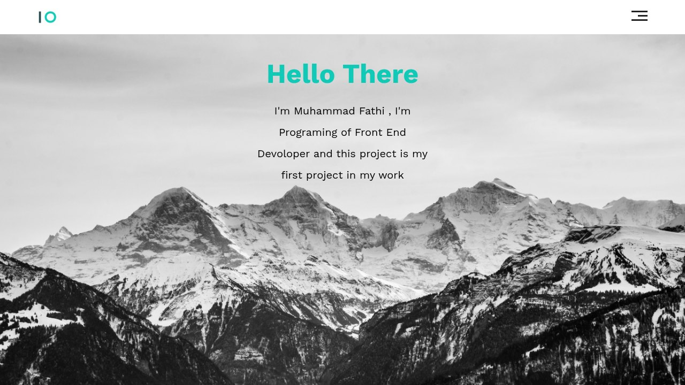

# Leon - HTML and CSS Project One

A one-page design agency website: hero, services, portfolio, about and contact. Built to practise HTML and CSS.

**See it:** https://mhmd7710d.github.io/HTML-And-CSS-Project-one/

## Sections
- Hero with the agency name and a short line.
- Services: three cards with icons.
- Portfolio: image cards with captions.
- About: text next to an illustration.
- Contact: layout only, it does not send anything.

## Built with
HTML and CSS, Flexbox and CSS Grid, Font Awesome icons, Normalize.css. No JavaScript and no framework.

## What I practised
Page structure and semantic HTML, Flexbox and Grid layouts, breakpoints for phone and desktop, hover and transition effects, and working with an icon font.

## Run it locally
Download the repository and open `index.html` in a browser.

## Credits
Based on Elzero Web School's HTML and CSS Template One (Leon). The content is practice material, not a real agency.

## Contact
- LinkedIn: https://www.linkedin.com/in/muhammad-fathi-b7a693424/
- X (Twitter): https://x.com/mouahid7710
- Facebook: https://www.facebook.com/share/1CQhxpCeYL/
- Instagram: https://www.instagram.com/mhmd7710d/
- Email: muhammutfathi@gmail.com
- WhatsApp: https://wa.me/201040428475?text=Hi+Mohammad%2C+I+found+your+project+on+GitHub.
